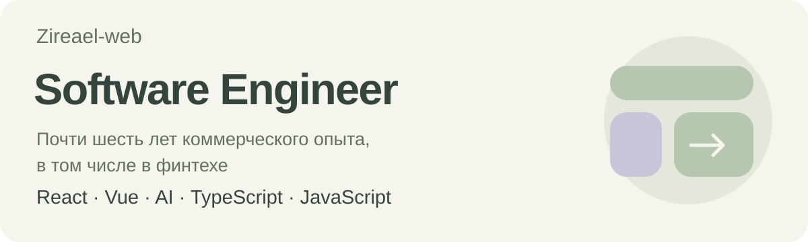
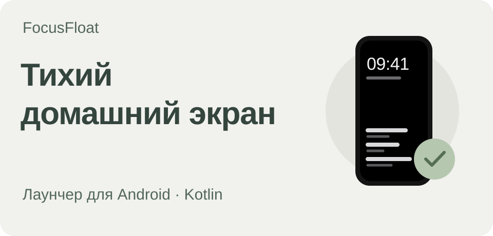
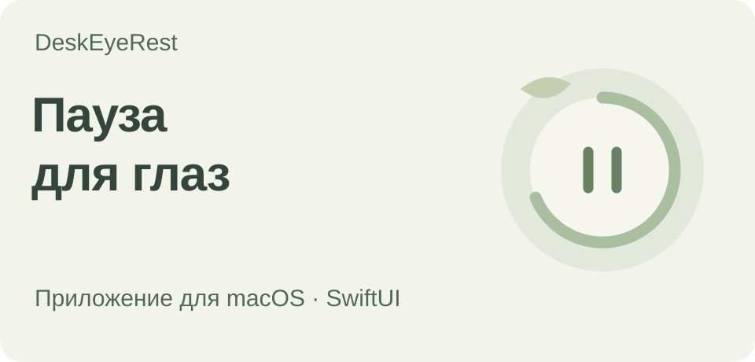

<picture>
  <source media="(prefers-color-scheme: dark)" srcset="assets/hero-dark.svg">
  <source media="(prefers-color-scheme: light)" srcset="assets/hero-light.svg">
  
</picture>

**Фронтенд:** React · Vue · TypeScript · JavaScript · WebSockets · gRPC · REST · HTML · CSS / SCSS · Micro frontends  
**Инструменты:** Webpack · Jest · Git · GitHub Actions 
**Браузерные расширения:** Chrome / Chromium · Manifest V3 · Web APIs

### Frontend-проекты

<table>
<tr>
<td width="50%" valign="top">

<strong><a href="https://github.com/Zireael-web/advanced-frontend-project">React-приложение</a></strong> React · TypeScript · Feature-Sliced Design

Тренировал дополнительный стек технологий вокруг экосистемы React, глубоко продумывал с нуля FSD-архитектуру большого продуктового приложения.

</td>
<td width="50%" valign="top">

<strong><a href="https://github.com/Zireael-web/youtube-caption-copy">YouTube Caption Copy</a></strong> JavaScript · расширение для Chrome · Manifest V3

Удобное копирование субтитров видео в буфер обмена.

</td>
</tr>
</table>

### Проекты на других языках

Делаю для собственных задач, заодно осваиваю другие языки и инструменты.

<table>
<tr>
<td width="50%" valign="top">

<strong><a href="https://github.com/Zireael-web/focus-float">FocusFloat</a></strong> Kotlin · Jetpack Compose · Android

Минималистичный чёрно-белый лаунчер для Android: отвлекающие приложения открываются только после осознанного подтверждения. <a href="https://zireael-web.github.io/focus-float/design/FocusFloat.html">Дизайн-прототип</a>

</td>
<td width="50%" valign="top">

<strong><a href="https://github.com/Zireael-web/health-evidence-workbench">Health Evidence Workbench</a></strong> Python · MCP · локальная обработка

Локальный инструмент на Python для работы с медицинскими документами и научными источниками. За основу идеи взял <a href="https://www.anthropic.com/news/claude-science-ai-workbench">Claude Science от Anthropic</a>.

</td>
</tr>
<tr>
<td width="50%" valign="top">

<strong><a href="https://github.com/Zireael-web/desk-eye-rest">DeskEyeRest</a></strong> Swift · SwiftUI · macOS

Приложение в строке меню macOS: помогает планировать перерывы от экрана и чередовать работу с отдыхом.

</td>
</tr>
</table>
