<picture>
  <source media="(max-width: 640px)" srcset="assets/hero-mobile.svg">
  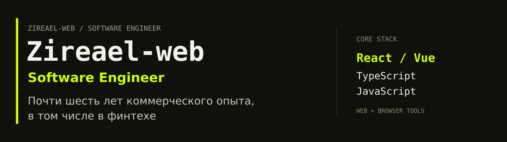
</picture>

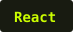 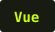 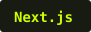 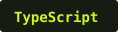 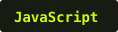 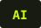 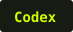 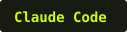 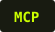 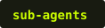

### Обо мне

```js
const zireael = {
  role:     "Software Engineer",
  stack:    ["React", "Vue", "Next.js", "TypeScript"],
  aiTools:  ["Codex", "Claude Code", "MCP", "sub-agents"],
  builds:   ["Web-интерфейсы", "Браузерные расширения"],
  explores: ["Kotlin", "Swift", "Python"],
};
```

### Рабочий стек

**Frontend:** React · Vue · Next.js · TypeScript · JavaScript · HTML5 · CSS3 / SCSS  
**Состояние, формы и навигация:** Redux · RTK Query · RxJS · React Hook Form · React Router · I18Next  
**UI и визуализация:** MUI · Tailwind CSS · Linaria · React Charts · TanStack Table  
**Архитектура:** BFF · Micro frontends · Module Federation · PWA  
**API и интеграции:** REST API · WebSockets · gRPC / gRPC-Web · Connect RPC · Axios  
**Сборка и тестирование:** Webpack · Vite · Jest · npm · yarn  
**Инструменты:** Git · GitHub Actions · Figma  
**AI-инструменты:** Codex · Claude Code · MCP · skills · sub-agents  
**Расширения:** Chrome / Chromium · Manifest V3 · Web APIs

### Frontend-проекты

<table>
<tr>
<td width="50%" valign="top">
<a href="https://github.com/Zireael-web/advanced-frontend-project">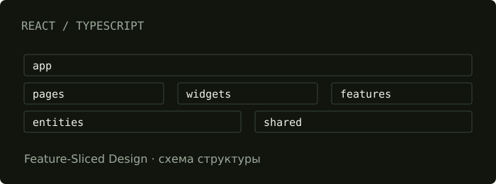</a>
<p><strong><a href="https://github.com/Zireael-web/advanced-frontend-project">Frontend Project</a></strong><br><sub>React · TypeScript · FSD</sub></p>
<p>С нуля продумывал и реализовывал FSD-архитектуру на большом React-приложении.</p>
</td>
<td width="50%" valign="top">
<a href="https://github.com/Zireael-web/youtube-caption-copy">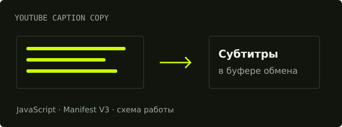</a>
<p><strong><a href="https://github.com/Zireael-web/youtube-caption-copy">YouTube Caption Copy</a></strong><br><sub>JavaScript · Chrome · Manifest V3</sub></p>
<p>Копирует доступные субтитры YouTube обычным текстом, без таймкодов и скачивания файлов. Работает локально в активной вкладке.</p>
</td>
</tr>
</table>

### Мой большой open source проект

<picture>
  <source media="(max-width: 640px)" srcset="assets/health-mobile.svg">
  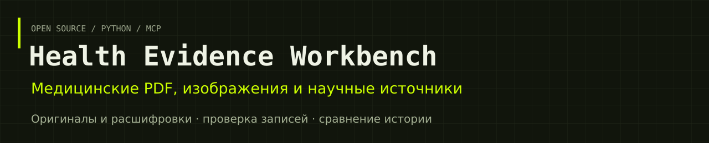
</picture>

**[Health Evidence Workbench](https://github.com/Zireael-web/health-evidence-workbench)** - набор Python-инструментов для работы с медицинскими документами и научными источниками в ChatGPT/Codex. Помогает сохранять оригиналы и расшифровки, проверять записи, сравнивать результаты во времени и искать научные публикации через PubMed и Crossref.

### Другие проекты и инструменты

Pet-проекты для собственных задач и изучения других языков.

| Проект | Для чего | Стек |
| --- | --- | --- |
| [FocusFloat](https://github.com/Zireael-web/focus-float) | Минималистичный Android-лаунчер с паузой перед запуском отвлекающих приложений | Kotlin · Jetpack Compose |
| [DeskEyeRest](https://github.com/Zireael-web/desk-eye-rest) | Перерывы от экрана из строки меню macOS | Swift · SwiftUI |
| [Lidless](https://github.com/Zireael-web/lidless) | Отключение встроенного экрана MacBook при подключённом внешнем мониторе | Swift · AppKit · SwiftUI |

Lidless использует приватные API macOS и может потребовать доработки после обновления системы.
